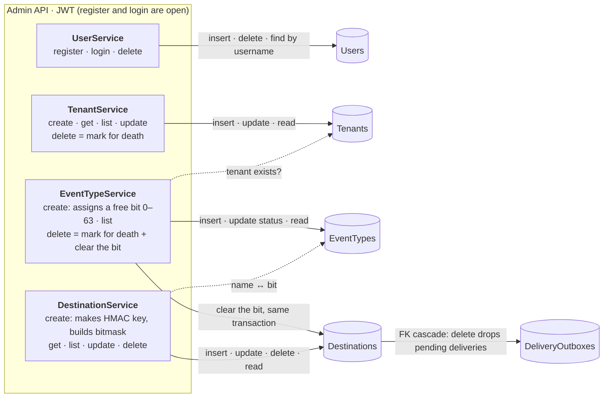
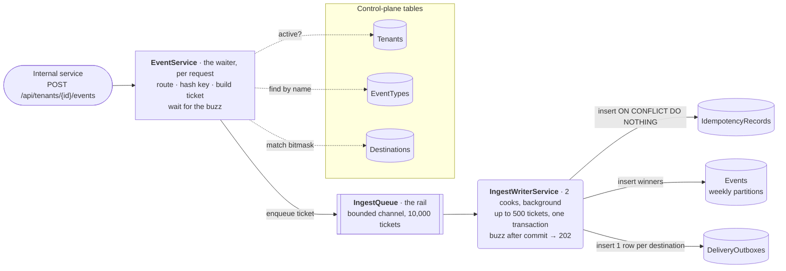
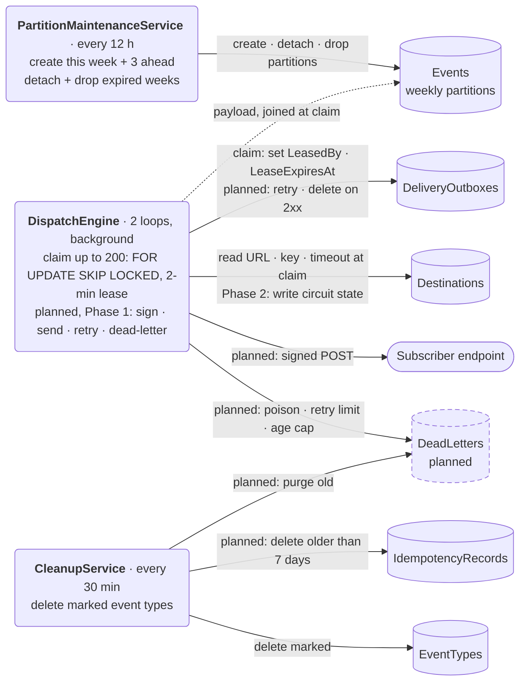

# DispatchForge architecture: who touches which table

Tables and columns live in [`schema.dbml`](schema.dbml). This file shows the code around them.
Keep both in sync with the code, in the same commit as the change.

**Legend**

- Rectangle = service (runs per HTTP request). Rounded = background worker. Cylinder = table. Double-edged box = in-memory queue.
- Solid arrow = writes (and may read). Dashed arrow = reads only.
- Dashed border or "planned" in a label = not built yet. The phase number refers to the plan.

## 1. Admin API (control plane)

## 2. Ingest path (one request)

## 3. Background workers

## Notes

- **Ownership rule:** HTTP services own the control-plane tables; background workers own the data-plane tables. Only two things cross: deleting a destination cascades into the outbox, and the DispatchEngine writes `CircuitState` (Phase 2).
- **Partition drop safety net:** the outbox → Events FK blocks dropping a week that still has pending deliveries. Retention (7 days) is longer than the outbox age cap (3 days), so it shouldn't happen.
- **Planned, not drawn yet:** the routing cache (Phase 4) replaces the 3 routing reads; the admin services will invalidate it when they change a tenant, event type or destination.
